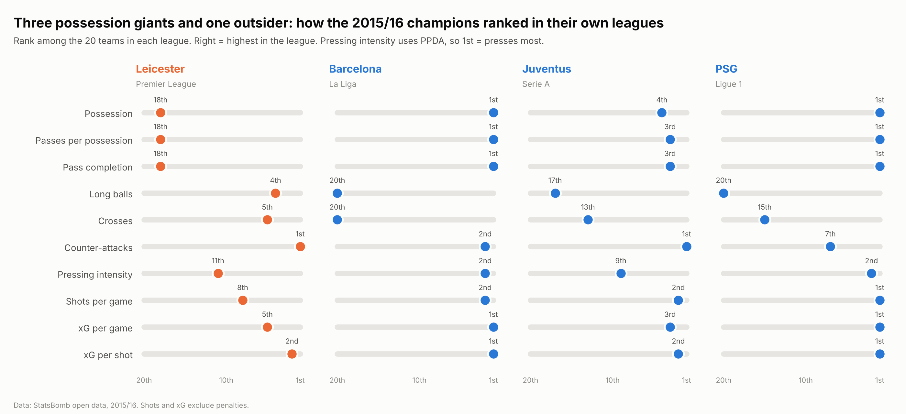
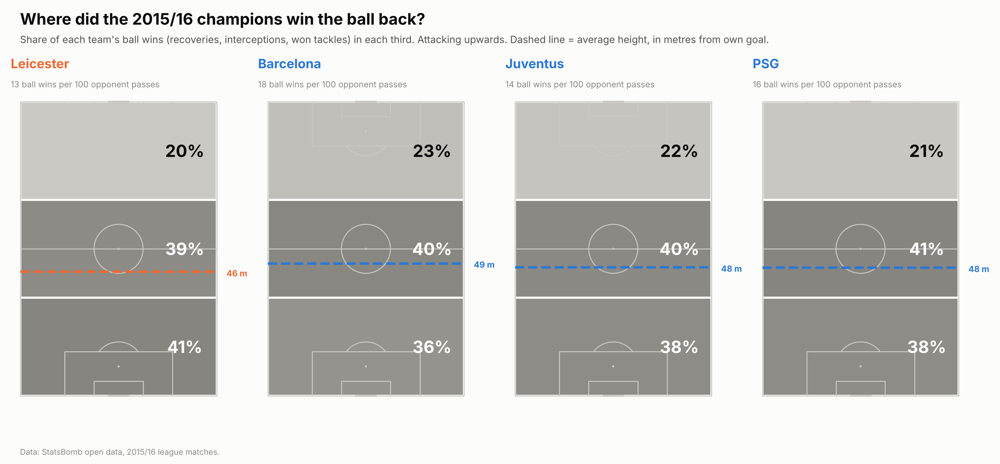
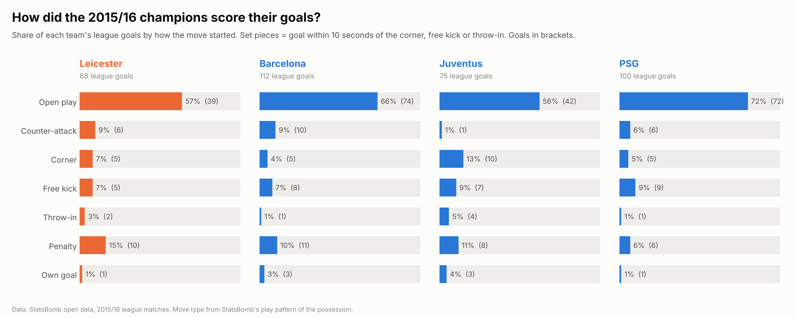
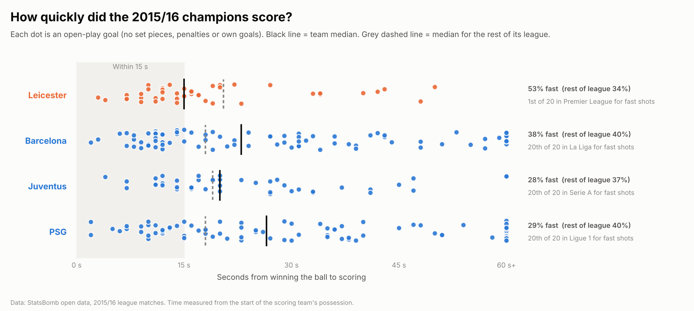

# How did the 2015/16 champions win their leagues?

A comparison of the four 2015/16 league champions using StatsBomb open event data:

| League | Champion |
|---|---|
| Premier League | Leicester City |
| La Liga | Barcelona |
| Serie A | Juventus |
| Ligue 1 | Paris Saint-Germain |

The project asks four simple questions, one chart each:

1. How did each champion play with the ball, compared with the rest of its league?
2. Where did they win the ball back?
3. How did their goals start?
4. How quickly did they score after winning the ball?

## Key findings

**1. Three possession giants and one outsider.** Barcelona and PSG ranked 1st in their leagues for possession, passes per possession and pass completion, and 20th for long balls. Juventus ranked 3rd or 4th on the same measures. Leicester ranked 18th of 20 for possession, passes per possession and pass completion, and 4th for long balls, but 2nd in the Premier League for xG per shot.



**2. Where they won the ball back mattered less than expected.** Average ball-win height ranged only from 46 m (Leicester) to 49 m (Barcelona) from their own goal. Leicester won the ball most often per game (72), but only because opponents had it far more against them. Per 100 opponent passes the order flips: Barcelona 18, PSG 16, Juventus 14, Leicester 13.



**3. Different routes to goal.** PSG scored 72% of their goals from open play and Barcelona 66%. Juventus relied most on set pieces (28% of goals came within 10 seconds of a corner, free kick or throw-in). Leicester had the highest share of goals from penalties (15%, 10 goals). StatsBomb's counter-attack tag showed Leicester at only 9%, the same as Barcelona, which part 4 tests directly.



**4. Leicester scored fast.** 53% of Leicester's open-play goals came within 15 seconds of winning the ball, against 34% for the rest of the Premier League. Leicester ranked 1st of 20 in the league for fast shots. Barcelona, Juventus and PSG each ranked 20th of 20, the slowest in their leagues. The pattern holds on all open-play shots (a larger sample than goals): 50% for Leicester against 33% for the rest of the league.



## Definitions

These choices are mine, and the results depend on them:

- **Possession** is the share of passes in the match (StatsBomb event data does not give possession time directly).
- **PPDA** (passes allowed per defensive action) = opponent open-play passes in their own defensive 60% of the pitch, divided by the team's tackles, interceptions and fouls in the same zone. Lower means more intense pressing.
- **Ball wins** = ball recoveries (excluding failed recoveries), interceptions that won the ball, and tackles that won the ball.
- **Set-piece goal** = a goal within 10 seconds of the corner, free kick or throw-in that started the possession. StatsBomb's play pattern labels a whole possession by how it started, so without this rule a goal after a 40-second passing move that began with a throw-in would count as a throw-in goal.
- **Fast goal** = an open-play goal scored within 15 seconds of the start of the scoring team's possession.
- **Shots and xG** exclude penalties throughout.
- **League comparison** in parts 1 and 4 compares each champion with the other 19 teams in its own league.

## Limitations

- One season, from 2015/16. This describes what the champions did, not why they won.
- PSG has 37 of their 38 league matches in the open data, so their totals cover 37 matches.
- StatsBomb's counter-attack tag is narrow, which is why part 4 measures speed directly instead.
- Dominant teams face deeper defences, so they have fewer chances to score quickly. Barcelona, Juventus and PSG ranking slowest is partly a consequence of their dominance.
- Small numbers in some categories (for example Leicester's 10 penalty goals) should not carry much weight.

## How to run

Requires Python 3.10 or later.

```bash
pip install -r requirements.txt

python part0_extract_team_features.py   # team features for all 1,517 matches (several minutes)
python part1_compare_champions.py
python part1_chart.py
python part2_ball_recoveries.py         # downloads the champions' match events to data/events/
python part3_goal_types.py
python part4a_league_baseline.py        # league baseline for part 4 (several minutes)
python part4b_goal_speed.py
```

Run the scripts from the repository folder, in this order. Each script prints its numbers before saving its chart. Tables are saved to `results/` and charts to `figures/`. Downloaded event files go to `data/`, which is not committed.

Charts use the Inter font if it is installed and fall back to the default font otherwise.

## A note on joining StatsBomb files

Some team names differ between StatsBomb's match files and event files (for example "Olympique de Marseille" and "Marseille"). All scripts match teams by team ID rather than by name.

## Data

Data: [StatsBomb open data](https://github.com/statsbomb/open-data). StatsBomb ask that any published work using the data credits StatsBomb as the source and uses their logo, available in their media pack.

## Author

Rafiz Rayhan · [GitHub](https://github.com/rafizrayhan) · [LinkedIn](https://www.linkedin.com/in/rafiz-rayhan)
